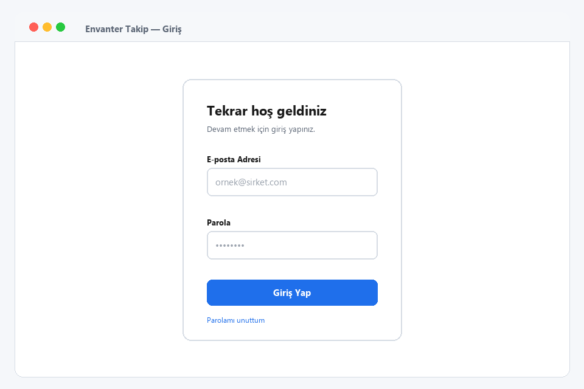
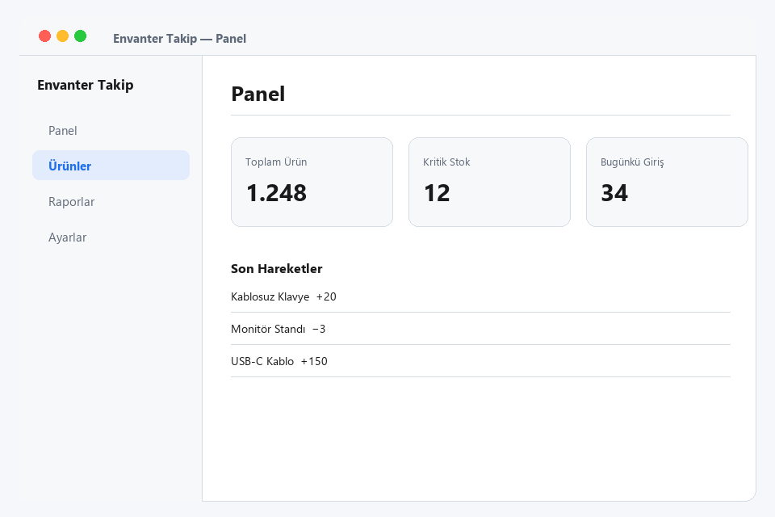
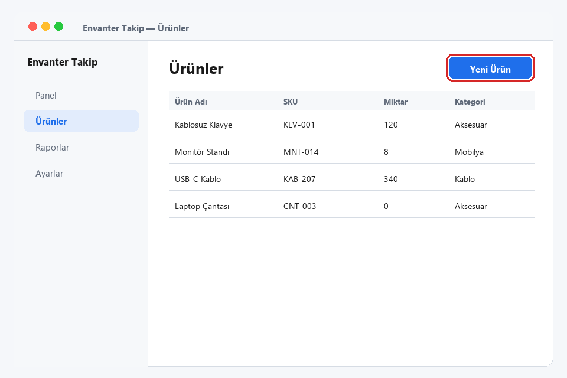
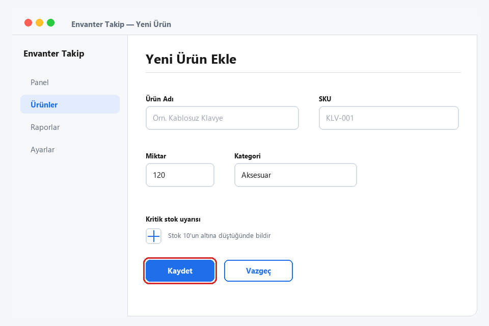
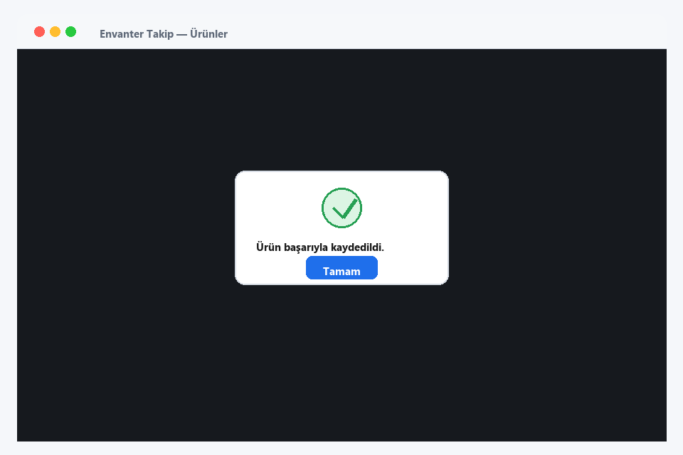
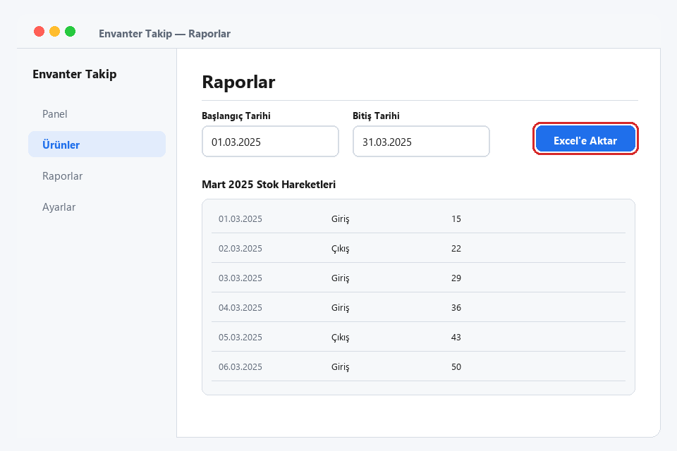

# Envanter Takip Kullanım Kılavuzu

**Sürüm 1.0** · **Son güncelleme:** 03.11.2026 · **Hedef kitle:** Tüm kullanıcılar

## Bölüm 1 — Sisteme Erişim

Bu bölümde Envanter Takip sistemine nasıl giriş yapacağınızı ve açılış ekranını
nasıl okuyacağınızı öğreneceksiniz.

**Adım 1.** Tarayıcınızda Envanter Takip adresini açınız. **E-posta Adresi** ve
**Parola** alanlarını doldurup **Giriş Yap** düğmesine tıklayınız.

Şekil 1 — Giriş ekranı

> **Not:** Parolanızı hatırlamıyorsanız giriş formundaki **Parolamı unuttum**
> bağlantısını kullanabilirsiniz.

**Adım 2.** Giriş sonrası **Panel** ekranı açılır. Bu ekranda **Toplam Ürün**,
**Kritik Stok** ve **Bugünkü Giriş** özet kartlarını, altında **Son Hareketler**
listesini görürsünüz.

Şekil 2 — Panel ekranı ve özet kartları

## Bölüm 2 — Ürün Ekleme

Bu bölümde listeye yeni bir ürün eklemeyi öğreneceksiniz.

**Adım 3.** Sol menüden **Ürünler** başlığına tıklayınız. Açılan listede
**Yeni Ürün** düğmesine tıklayınız.

Şekil 3 — Ürünler listesi ve Yeni Ürün düğmesi

**Adım 4.** Açılan formda **Ürün Adı**, **SKU**, **Miktar** ve **Kategori**
alanlarını doldurunuz. Stok uyarısı almak istiyorsanız **Stok 10'un altına
düştüğünde bildir** onay kutusunu işaretleyip **Kaydet** düğmesine tıklayınız.

Şekil 4 — Yeni ürün formu

> **Uyarı:** Formu doldurup **Vazgeç** düğmesine basarsanız girdiğiniz bilgiler
> kaydedilmez.

**Adım 5.** Kayıt tamamlandığında **Ürün başarıyla kaydedildi.** iletisi
görüntülenir. **Tamam** düğmesine tıklayarak iletiyi kapatınız.

Şekil 5 — Kayıt onay iletisi

## Bölüm 3 — Rapor Alma

Bu bölümde stok hareketlerini rapor olarak dışa aktarmayı öğreneceksiniz.

**Adım 6.** Sol menüden **Raporlar** başlığına tıklayınız. **Başlangıç Tarihi** ve
**Bitiş Tarihi** alanlarını doldurup **Excel'e Aktar** düğmesine tıklayınız.

Şekil 6 — Raporlar ekranı ve Excel'e Aktar düğmesi

> **Not:** Rapor, seçtiğiniz tarih aralığındaki stok hareketlerini içerir.

## Bölüm 4 — Sık Sorulan Sorular

**Kaydettiğim ürünü listede göremiyorum, ne yapmalıyım?**
Ürün listesinde doğru sekmeyi görüntülediğinizden emin olunuz. Sorun sürüyorsa
sistem yöneticinizle iletişime geçiniz.

**Rapor dosyası neden açılmıyor?**
**Excel'e Aktar** düğmesiyle indirilen dosya tablo biçimindedir; tablo
uygulamanızda açınız.

**Hangi alanlar zorunludur?**
**Ürün Adı** ve **SKU** alanları, listede ürünü ayırt etmek için kullanılır.

---

## Açık Sorular / Open Questions

- **[?]** **Tamam** düğmesine basıldıktan sonra ürün listesinin otomatik
  güncellenip güncellenmediği ekran görüntülerinden doğrulanamıyor. Bu davranış
  için ek bir ekran görüntüsü gerekli.
- **[?]** Adım 4'teki onay kutusunun varsayılan durumu görselde net değil.

## Terimler

| Terim | Anlamı |
|---|---|
| SKU | Ürün stok kodu |
| Kritik Stok | Belirlenen eşiğin altına düşen ürün adedi |